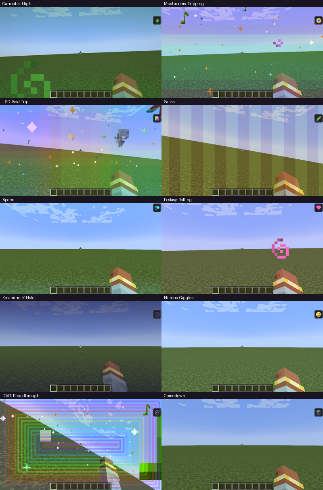

# High Life

A NeoForge **1.21.1** mod for our All the Mods 10 server. It adds cannabis, magic mushrooms, tobacco, coca, salvia, LSD, speed, ecstasy, ketamine, nitrous and DMT.
Every drug has its own screen effect, sounds, gameplay effect and chat effect. It's built as an add-on for
[Smoke Break](https://www.curseforge.com/minecraft/mc-mods/smoke-break).

Everything here is fictional game content. The crafting recipes are made up and have nothing to do with how anything is made in real life.



## Requirements

| | |
|---|---|
| Minecraft | 1.21.1 |
| NeoForge | 21.1.265 or newer |
| [Smoke Break](https://www.curseforge.com/minecraft/mc-mods/smoke-break) | 2.0.0 or newer, **on both the client and the server** |

High Life has to be installed on the **server and every client**.

## What's in it

| Drug | Source | Use | Effect |
|---|---|---|---|
| Cannabis | seeds from grass, then grow, dry, grind | joint (Smoke Break cigarette + weed, lit with a lighter), bong, pot brownie, Smoke Break vape with Cannabis Distillate | High: munchies, slow healing, green haze |
| Magic mushrooms | dark forests, swamps, taigas, normal mushrooms | eat, or mushroom tea | Tripping: rainbow screen, hallucinated mobs, whispers |
| LSD | ergot from ripe wheat | blotter | Acid Trip: kaleidoscope screen, nearby mobs glow |
| Salvia | seeds from grass | bong | sideways shoves, tilted world, "zipper" stripes |
| Speed | crafted | pill | fast, no sleep, racing heart, comedown |
| Ecstasy | crafted | pill | techno in your head, animals fall in love, comedown |
| Ketamine | crafted | snort | K-hole: slow motion, floating, droning hum |
| Nitrous | crafted | balloon | giggles and "wah-wah-wah" |
| DMT | crafted | bong | white-out, rainbow tunnel, machine elves |
| Tobacco | seeds from grass | crafts Smoke Break cigarettes | |
| Coca | seeds from jungle grass | cocaine | Wired, comedown, overdose on a 3rd bump |

## Building

```
./gradlew build                # jar in build/libs/highlife-<version>+neoforge-1.21.1.jar
./gradlew runGameTestServer    # 8 automated server tests (includes a real Smoke Break vape puff)
./gradlew runSelftest          # real client: cycles every effect and saves screenshots to run/screenshots
```

Smoke Break is pulled from CurseForge Maven when you build. It's never included in this repo.
Textures, sounds and data are generated by the scripts in `tools/` (`gen_textures.py`, `gen_sounds.py`,
`gen_data.py`, `make_icon.py`).

## Releases (Hopper)

Releases follow the Hopper release kit: pushing a `v<version>` tag builds the mod and publishes a GitHub Release with
`highlife-<version>+neoforge-1.21.1.jar`. In Hopper, add the source `github:maximdel/high-life`.
